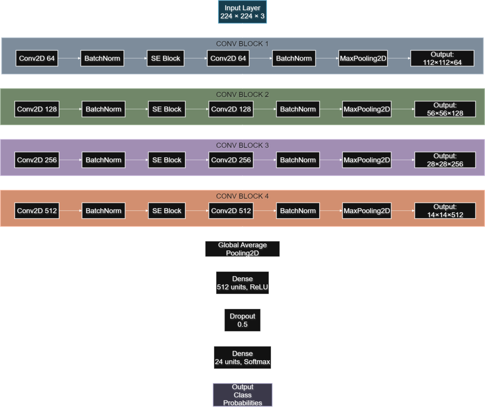
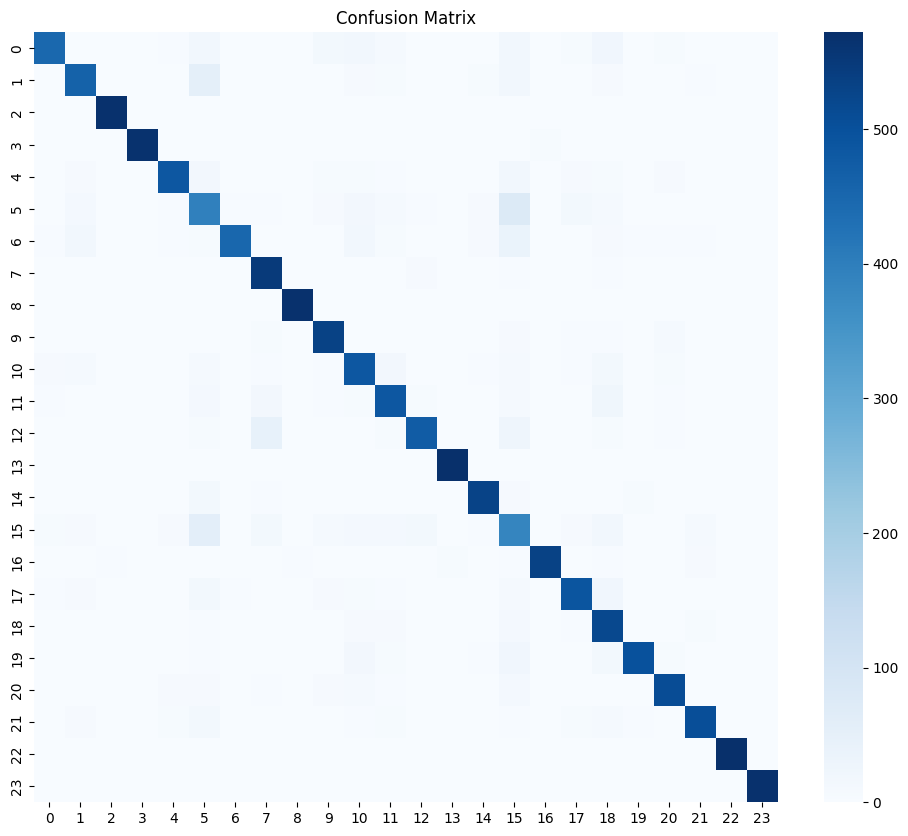
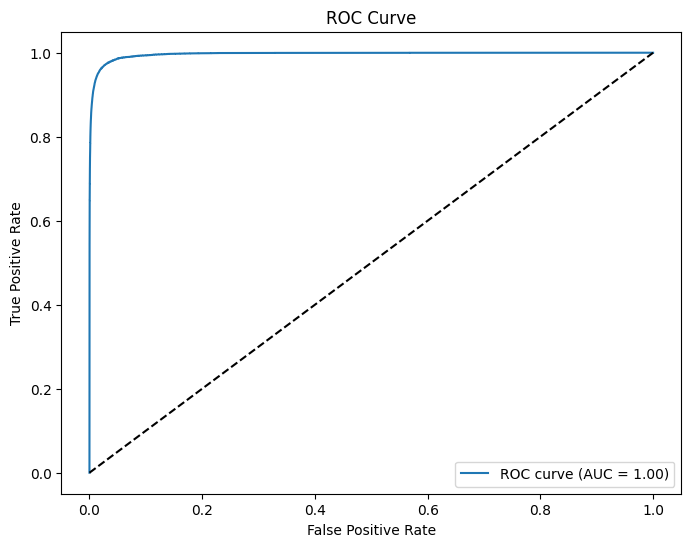

# SE-CNN: Squeeze-and-Excitation Channel Attention for 24-Class Skin Disease Classification

Code, figures and paper for **"Squeeze-and-Excitation Channel Attention in a Compact CNN for 24-Class Clinical Skin Disease Classification"**, Md. Ariful Islam (preprint, 2026).

- 📄 **Paper:** [`paper/Islam_SE-CNN_Skin_Disease_IEEE.pdf`](paper/Islam_SE-CNN_Skin_Disease_IEEE.pdf)
- 📓 **Notebook, with the original training and evaluation outputs:** [`notebooks/se_cnn_skin_disease.ipynb`](notebooks/se_cnn_skin_disease.ipynb)

## Summary

A compact CNN trained from scratch, with a Squeeze-and-Excitation (SE) block in each of its four convolutional stages, that classifies clinical (non-dermoscopic) skin photographs into 23 disease categories plus healthy skin.

| | |
|---|---|
| Dataset | Public *SkinDisease* collection on Kaggle; 24 of 35 folders used, each undersampled to 2,857 images (68,568 total) |
| Split | Random 80/20 image-level split: 54,840 train / 13,728 held-out (572 per class) |
| Model | 4 conv stages (64-128-256-512), SE ratio 16, global average pooling, Dense 512, dropout 0.5; **5.01 M parameters** |
| Training | Adam 1e-4, batch 64, up to 30 epochs, early stopping on held-out loss (patience 5) |
| Held-out accuracy | **88.55%** |
| Macro F1 | **0.888** |
| Micro-averaged ROC AUC | 1.00 |
| SE ablation (reduced subset) | validation accuracy 64.2% → 73.1%, test macro F1 0.49 → 0.59, for <1% more parameters |



<p float="left">
  
  
</p>

## Limitations (also stated in the paper)

- The split is at **image level**. The source collection has no patient IDs, so near-duplicate photos of the same lesion may fall on both sides of the split.
- The 20% held-out split was **also used as the validation set for early stopping and checkpoint selection**, so it is not a fully independent test set and the reported numbers are optimistic.
- There is no external test set and no cross-validation. Both are listed as future work in the paper.

## Reproducing

1. Download the dataset from Kaggle: <https://www.kaggle.com/datasets/sheikhresearch/skindisease>
2. Install the requirements: `pip install -r requirements.txt`
3. Point `train_dir` and `test_dir` in the notebook at your local copy and run the cells in order. The original run used Kaggle with a Tesla P100 GPU.

## Citation

```bibtex
@misc{islam2026secnn,
  author = {Md. Ariful Islam},
  title  = {Squeeze-and-Excitation Channel Attention in a Compact CNN for 24-Class Clinical Skin Disease Classification},
  year   = {2026},
  note   = {Preprint}
}
```

## License

Code: MIT. The dataset has its own Kaggle license and is not redistributed here.

Contact: sm.islam.ariful@gmail.com
